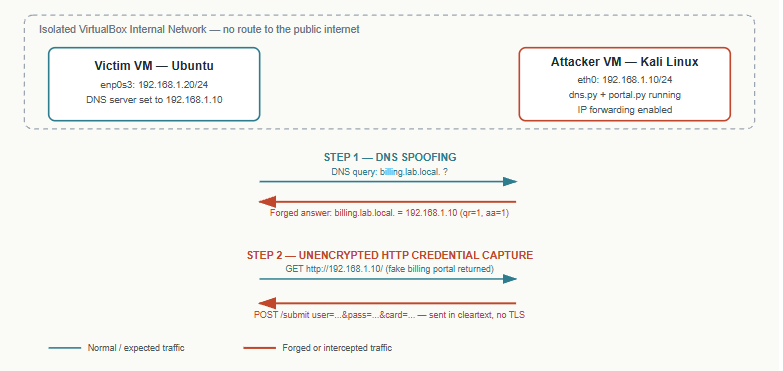

# DNS Spoofing & Unencrypted HTTP Credential Interception — Isolated Lab


> [!WARNING]
> **Educational, isolated-lab use only.** Everything in this repository was built and run entirely inside a private VirtualBox "Internal Network," with no route to the public internet and no real users, services, or data involved. The attacker and victim machines were both my own VMs. Do not run this code against any network, device, or person without explicit written authorization, doing so is illegal in most jurisdictions.
> This project exists to teach why these attacks work and how to defend against them, not to enable attacking real systems.

---

## What This Lab Demonstrates
Two-stage attack chain against a victim machine that has no DNS integrity protection and visits a site over plain HTTP:

1. **DNS Spoofing** ,forging a fake DNS answer so a hostname resolves to the attacker's IP instead of the real one.
2. **Unencrypted HTTP Credential Interception**, hosting a fake login form on that IP and capturing whatever the victim types, in plaintext, because there's no TLS/HTTPS encryption protecting it.

Full Report with analysis and remediation steps: DNS_Spoofing_Lab_Report.pdf

---

## Network & Attack-Flow Diagram

 
 


---

## Technologies Used

| Component          | Role in the Lab                                             | Why It Matters                                    |
|---------------------|---------------------------------------------------------------|------------------------------------------------------|
| VirtualBox          | Hypervisor hosting both VMs on an isolated Internal Network   | Guarantees no traffic reaches the real internet       |
| Kali Linux          | Attacker VM                                                    | Pre-loaded with Python, Scapy, standard tooling        |
| Ubuntu Desktop      | Victim VM                                                      | Represents a typical end-user machine                 |
| Python 3            | Scripting language for both tools                              | Readable, beginner-friendly, no compilation step       |
| Scapy               | Python packet-crafting library                                 | Lets dns.py sniff and forge raw DNS packets            |
| http.server         | Python's built-in HTTP server module                           | Powers portal.py with zero external dependencies       |
| Firefox             | Browser used on the victim VM                                  | Shows the real-world "Not Secure" HTTP warning         |

---

## Quick-Start (Reproduction Steps)

All steps assume the VirtualBox topology described in the reprot: two VMs on one isolated Internal Network, no gateway, no internet access.

1. Clone this repo onto the attacker (Kali) VM:
   ```bash
   git clone https://github.com/<your-username>/<your-repo>.git
   cd <your-repo>
   ```
2. Install the one external dependency (Scapy):
   ```bash
   sudo pip install scapy --break-system-packages
   ```
3. Enable IP forwarding on the attacker VM:
   ```bash
   sudo sysctl -w net.ipv4.ip_forward=1
   ```
4. Start the fake HTTP portal (needs root to bind port 80):
   ```bash
   sudo python3 portal.py
   ```
5. In a second terminal, start the DNS spoofer:
   ```bash
   sudo python3 dns.py
   ```
6. On the victim VM, confirm its DNS server is manually set to `192.168.1.10` (e.g. `resolvectl status`), then browse to `http://billing.lab.local` or type the ip if the link doesnt work.
7. Watch `dns.py` print the forged answer, and `portal.py` print the captured form submission in plaintext.
8. Stop both scripts with `Ctrl+C` when done, and follow the remediation section in the report to reverse the lab's misconfiguration.

---

## Code Explanation

### dns.py how DNS spoofing works here

DNS is like a phonebook: a device asks "what's the number (IP address) for this name?" The catch is that classic DNS over UDP port 53 has no built-in way to verify who answered and whichever reply arrives first with a matching Transaction ID is trusted. That's the weakness this script exploits.

| Code | Plain-English meaning |
|---|---|
| `sniff(iface="eth0", filter="udp port 53", prn=handle_pkt)` | Watch all traffic on eth0, but only hand DNS (port 53) packets to our function |
| `pkt[DNS].qr == 0` | `qr` = Query/Response flag. 0 means this packet is a question, not an answer |
| `pkt.haslayer(DNSQR)` | DNSQR = "DNS Question Record" — confirms there's a readable question inside |
| `qname = pkt[DNSQR].qname.decode(...)` | Pulls the requested hostname out of the raw packet bytes |
| `IP(src=pkt[IP].dst, dst=pkt[IP].src)` | Builds the reply's IP layer, swapping source/destination so it looks like it came from the real server |
| `UDP(sport=pkt[UDP].dport, dport=53)` | Keeps the ports consistent with the original query so the victim's OS accepts the reply |
| `DNS(id=pkt[DNS].id, qr=1, aa=1, ...)` | `id` must match the original query's Transaction ID; `qr=1` marks this as an answer; `aa=1` claims "Authoritative Answer" to look more convincing |
| `an=DNSRR(rrname=..., ttl=30, rdata=FAKE_IP)` | DNSRR = "DNS Resource Record" — this is the forged answer: "this hostname = our attacker IP," cached for 30 seconds |
| `send(reply, verbose=False)` | Fires the forged packet onto the network |

### portal.py how the credential capture works here

| Code | Plain-English meaning |
|---|---|
| `HTTPServer(("0.0.0.0", 80), Handler)` | Listens on every network interface, on port 80 (the standard unencrypted HTTP port) |
| `def do_GET(self):` | Runs automatically whenever a browser just loads the page — sends back the fake login HTML |
| `def do_POST(self):` | Runs automatically whenever the victim clicks "Submit" |
| `length = int(self.headers.get("Content-Length", 0))` | Finds out how many bytes of form data are coming |
| `body = unquote(self.rfile.read(length).decode(...))` | Reads and decodes the raw form data — because there's no HTTPS, this arrives as readable plaintext |
| `print(f"[!] Captured POST ...")` | This line is the vulnerability made visible: a network eavesdropper can read it just as easily as this script can |

---


## Defensive Takeaways

- Never let a device trust DNS answers without verification — use DNSSEC and/or DNS over HTTPS/TLS (DoH/DoT).
- Always serve anything handling credentials over HTTPS/TLS, which also makes spoofed hosts trigger certificate warnings.
- On real networks, enable DHCP Snooping and Dynamic ARP Inspection on managed switches to block this class of attack at Layer 2.
- Host-level firewall rules (for example, `ufw deny from <rogue-ip> to any port 53`) are a useful secondary layer, not a substitute for the above.

See full report for the remediation walkthrough.

---

## License

This repository is currently unlicensed. All rights are reserved by the author; no permission is granted to copy, modify, or redistribute this code without prior consent.
